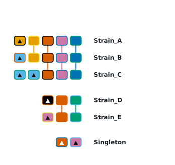

# CRISPRMap

## Overview

CRISPRMap is a local command-line tool for visualizing and comparing ordered CRISPR spacer arrays. It accepts existing spacer IDs or spacer sequences, and produces array maps, prevalence plots, similarity heatmaps, networks, and statistics. It runs without a web service or graphical desktop.

## 1. Features

| Command        | Result                                                                    |
| -------------- | ------------------------------------------------------------------------- |
| `map`        | Spacer array diagram with shared-spacer links and array-specific markers. |
| `occurrence` | Spacer prevalence bars and an array-by-spacer presence/absence matrix.    |
| `heatmap`    | Pairwise similarity heatmap based on the order of spacer IDs.             |
| `network`    | Array clustering network, including isolated arrays.                      |
| `stats`      | Complete spacer prevalence statistics in JSON; no figure is generated.    |

## 2. Installation

Python 3.10 or later is required. Download or clone this repository and open a terminal in the `CRISPRMap` directory. Installation also installs the required Matplotlib, NumPy, and NetworkX dependencies.

### Linux

```bash
cd /path/to/CRISPRMap
python3 -m venv .venv
source .venv/bin/activate
python -m pip install .
crisprmap --help
```

### Windows PowerShell

```powershell
Set-Location E:\CRISPRMap  # Replace with your repository path
python -m venv .venv
.\.venv\Scripts\python.exe -m pip install .
.\.venv\Scripts\crisprmap.exe --help
```

The usage examples below assume that `crisprmap` is on your PATH. On Windows, use `.\.venv\Scripts\crisprmap.exe` in its place when the virtual environment is not activated.

## 3. Input Formats

All five commands accept the formats below. Detection is based on the path: `.csv` and `.json` select CSV and JSON, a directory selects FASTA, and other files are read as text. Override this with `--input-format text|csv|json|folder`. Sequence inputs are normalized for orientation and assigned spacer IDs; text IDs are used as supplied.

### TXT: numbered arrays

Use UTF-8, with one array per line. Separate its unique name and spacer IDs with whitespace or a tab; use a tab when a name contains spaces. Separate IDs with commas, semicolons, or whitespace. Blank lines and lines starting with `#` are ignored. Each array must contain at least one ID.

```text
Strain_A    1,2,3,4
Strain_B    5,2,3,4
Strain_C    6,6,3
```

IDs are strings, so `01` and `1` differ. Repeated occurrences are retained. Provide arrays in a consistent orientation, particularly for ancestral-spacer grouping. See [examples/arrays.txt](examples/arrays.txt).

### CSV: spacer sequences

Provide one spacer per row with `Seq_Name`, `Orientation`, and `Spacer_Sequence` columns. `Folder`, `Organism_Name`, and `Reverse_Complement_Sequence` are optional.

```csv
Folder,Seq_Name,Orientation,Spacer_Sequence
sample,array1,+,AACGTACCAA
sample,array1,+,CCATGGTACC
sample,array2,-,GGTACCATGG
sample,array2,-,TTGGTACGTT
```

For raw CSV, rows are in genomic order; `--csv-mode raw` reverses negative arrays and reverse-complements their sequences. For processed CSV, rows are already in display order; use `--csv-mode processed`. The original genomic-strand sequence remains in `Spacer_Sequence`; an optional `Reverse_Complement_Sequence` supplies the negative-strand reverse complement. The default `auto` selects processed mode when that column exists, otherwise raw mode. Unknown orientations are skipped with a warning; N-containing spacers trigger filtering as described in [input details](docs/INPUTS.md). See [raw](examples/spacers-raw.csv) and [processed](examples/spacers-processed.csv) examples.

### JSON: CRISPRCasFinder output

Supply one CRISPRCasFinder result file with `Sequences`, `Crisprs`, and `Regions`. Arrays need unique `Name` values; only evidence levels 3 and 4 and regions of type `Spacer` are retained. Orientation comes from `Potential_Orientation`, falling back to `CRISPRDirection` when unknown. Provide original region order and sequences; negative arrays are normalized automatically.

```json
{"Sequences": [{"Crisprs": [{
  "Name": "array1", "Evidence_Level": 4, "Potential_Orientation": "+",
  "Regions": [{"Type": "Spacer", "Sequence": "AACGTACCAA"}]
}]}]}
```

See the complete [JSON example](examples/crisprcasfinder.json).

### FASTA: direction-labelled folders

Supply a directory containing `.fa`, `.fasta`, or `.fna` files. Each file represents one array, and each FASTA record represents one spacer. Files are read recursively; directory names must identify direction using tokens such as `pos`, `positive`, `forward`, `neg`, `negative`, or `reverse`.

```text
spacers/
  pos/strain_A.fasta
  neg/strain_B.fasta
```

```fasta
>spacer1
AACGTACCAA
>spacer2
CCATGGTACC
```

By default, bases are already strand-normalized and records are in genomic order; negative-array order is reversed. Use `--fasta-sequences genomic` for raw genomic-strand bases, or `--fasta-order oriented` when records are already in display order. Empty records, ambiguous directions, and N-containing sequences are rejected. See [examples/spacers](examples/spacers) and [orientation details](docs/INPUTS.md).

## 4. Usage

Run commands from the repository root to use the included examples:

```bash
crisprmap map -i examples/arrays.txt -o results/map.svg --cluster shared-spacer
crisprmap occurrence -i examples/arrays.txt -o results/occurrence.png
crisprmap heatmap -i examples/arrays.txt -o results/heatmap.pdf
crisprmap network -i examples/arrays.txt -o results/network.svg --cluster shared-spacer
crisprmap stats -i examples/arrays.txt -o results/stats.json
```

Example array map generated from `examples/arrays.txt` with the first command:



To normalize sequence inputs and save the assigned IDs for reuse:

```bash
crisprmap map -i examples/spacers-raw.csv -o results/from-csv.svg --csv-mode raw --numbered-out results/arrays.txt --mapping-out results/mapping.tsv
crisprmap map -i examples/crisprcasfinder.json -o results/from-json.svg
crisprmap map -i examples/spacers -o results/from-fasta.svg
crisprmap heatmap -i results/arrays.txt -o results/sequence-heatmap.pdf
```

| Option                                   | Purpose                                                                                                                         |
| ---------------------------------------- | ------------------------------------------------------------------------------------------------------------------------------- |
| `-i`, `--input`                      | Input file or FASTA directory; required.                                                                                        |
| `-o`, `--output`                     | Output image or, for `stats`, JSON file; required. Parent directories are created as needed.                                  |
| `--input-format`                       | Override input detection: `text`, `csv`, `json`, or `folder`.                                                           |
| `--identity-threshold`                 | Sequence clustering identity threshold, greater than 0 and at most 1; default `0.84`.                                         |
| `--csv-mode`                           | CSV orientation convention: `auto`, `raw`, or `processed`.                                                                |
| `--fasta-sequences`, `--fasta-order` | Set FASTA sequence and record-order conventions to `genomic` or `oriented`.                                                 |
| `--numbered-out`, `--mapping-out`    | Save reusable numbered arrays and the ID-to-sequence TSV, respectively. Mapping requires sequence input.                        |
| `--align`                              | For `map`: `left`, `right` (default), or `justify`.                                                                     |
| `--cluster`                            | For `map`: `none` (default), `shared-spacer`, or `ancestral-spacer`; for `network`, the default is `shared-spacer`. |
| `--seed`                               | Non-negative color/layout seed for `map` and `network`; default `2`.                                                      |
| `--format`, `--dpi`                  | Image format and resolution for plot commands; format normally follows the output suffix, and DPI defaults to 300.              |
| `--summary`                            | For plot commands, additionally save statistics as JSON.                                                                        |
| `--force`                              | Overwrite existing output files.                                                                                                |

Image formats include SVG, PNG, PDF, JPG/JPEG, TIFF/TIF, EPS, PS, and WebP; raster format availability depends on the local installation. DPI ranges from 36 to 2400 and does not affect directly generated map or occurrence SVGs. PS/EPS does not preserve transparency. Input and output paths must be distinct, and outputs must be outside an input FASTA directory. Use `crisprmap --help` or `crisprmap map --help` for full options.

## 5. Output Interpretation

- **Array map:** Boxes represent spacer occurrences; links connect shared spacer IDs. Triangles mark IDs found in only one array, including each repeated copy in that array. Alignment changes layout; `justify` preserves spacer order and is a heuristic, not a multiple sequence alignment.
- **Occurrence:** Bars count how many arrays contain each spacer, counting an array once even if the spacer repeats. The matrix shows presence or absence. The plot supports at most 50 distinct IDs; use `stats` for complete counts on larger datasets.
- **Array grouping:** `shared-spacer` connects pairs sharing at least two distinct IDs; connected components form groups. `ancestral-spacer` groups by the rightmost ID and requires consistent orientation; it is a positional heuristic, not an ancestral reconstruction.
- **Heatmap:** Each cell compares two ordered ID arrays using `1 - edit distance / max(array lengths)`. Edit distance is Levenshtein distance over spacer IDs, not nucleotide sequences; 1 means identical ordered arrays.
- **Network:** Nodes represent arrays and colors indicate groups. Edges represent pairwise clustering links and their weights count distinct shared IDs. Isolated nodes are retained; numbered nodes correspond to names in the key. The seed controls the layout.
- **Sequence-to-ID clustering:** For CSV, JSON, and FASTA input, global Needleman–Wunsch alignment uses match +1, mismatch −1, and gap −2. Identity is matching bases divided by alignment length. Sequences meeting the threshold are linked, and connected components receive IDs; therefore, two sequences in one component may be linked transitively even if their direct identity is below the threshold. IDs are local to a dataset and can change with input content, order, or threshold.

See [input formats and orientation rules](docs/INPUTS.md) for filtering, numbering, and additional examples.
